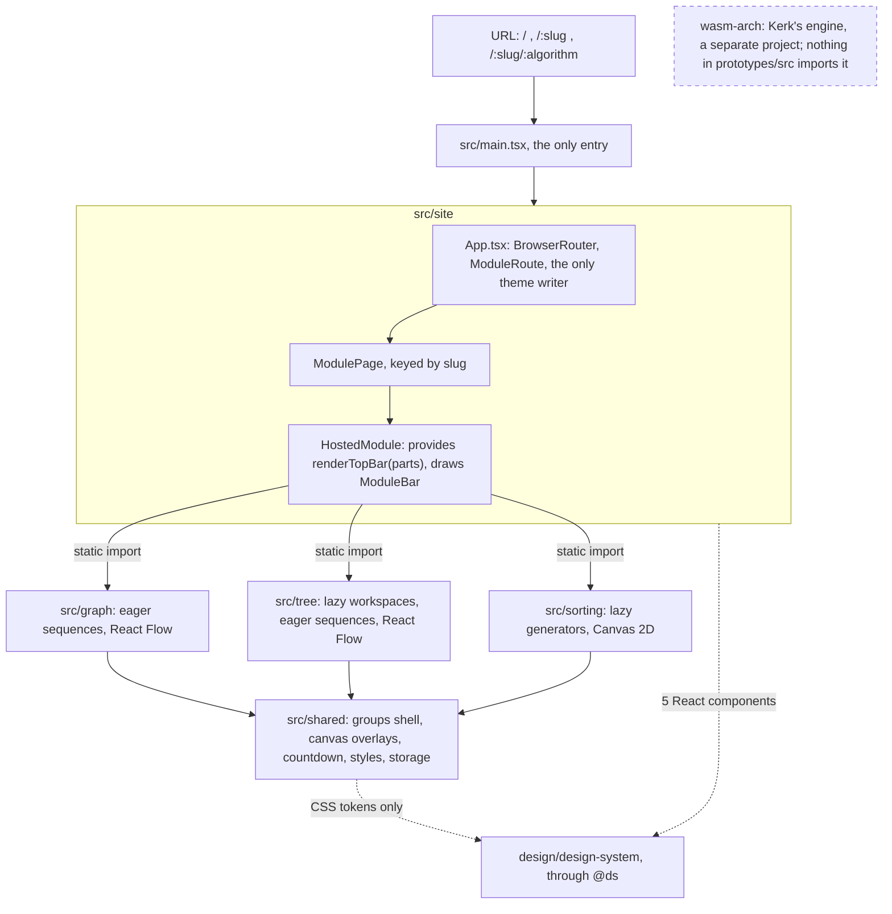
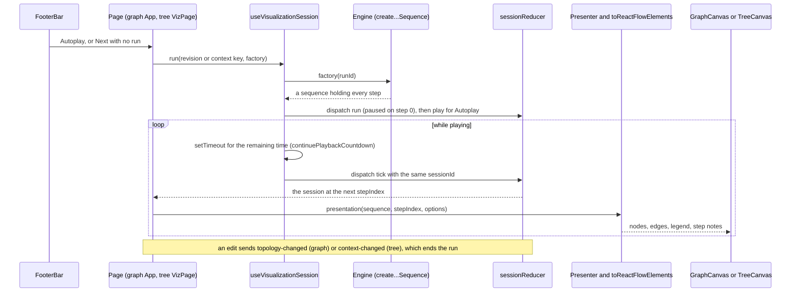
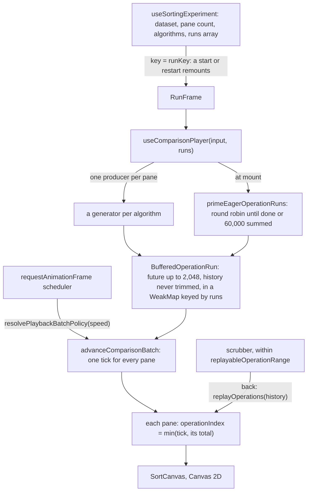

# 03 · Architecture and design decisions

Audit date: 2026-11-01/02 \
Repository: `kerktaiheng/visualgo-plus-design`, `main` at `662e7b3` \
Evidence labels: VERIFIED / DOCUMENTED / INFERENCE / QUESTION \
The owner's answers of 2026-11-01 and 2026-11-03 are applied, as set out under "How to read this document".

## How to read this document

- **Scope.** Section 1 is the app on `main` at `662e7b3`. Section 2 is the earlier and experimental architectures and their status. Section 3 is the design decisions that matter for the report, with who decided each. Section 4 separates documented rationale from inference. Contribution ids (C1 to C14) and question ids (Q1 to Q17) are those of note 09.
- **Evidence.** The phase-1 notes 01 to 09 (`evidence/research-notes/`), the decision records, and my own read-only checks on 2026-11-02: `git show`, `git log`, `git blame -w`, `git ls-tree`, blob hashes against the standalone clones, and `grep` over an archive of `662e7b3`. I ran no tests; I only checked that the four diagrams render (Mermaid 11.4.1 in headless Chromium, 2026-11-02). Test results come from the audit-time run of 2026-11-01 (note 07 §2): typecheck clean; lint 0 errors, 2 warnings; 654 node:test and 2,619 vitest cases (3,273 unit cases); the build; 151 of 151 browser cases.
- **Paths** are repository-relative; a file in a standalone repository starts with the repository's name (`graph-visualizer-v2/src/...`). Hashes have 7 characters.
- **The owner's answers** are applied as in doc 01 (the table at its top). Here they mean: "Bao" is the two BJoozz identities, both his; the split of work between Kerk and Bao is a working description; the AI assistants worked under Bao's requests, choices and confirmation, so AI-assisted work is his; records that name no person are implementer's defaults he accepted, so they are his decisions; the V10 choices 27 to 48 and the other "owner" wording in Kerk's commits were decided by Kerk and Bao together and implemented by Kerk. Week 0 is the work from 2026-07-28 to about 08-09; the FYP proper began in Week 1 of the semester, about 2026-08-10 (exact date to confirm).

**Who decided.** These tags are used in section 3 and wherever a decision is credited. The decider is always kept apart from the implementer.

| Tag | Meaning | Label |
| --- | --- | --- |
| **Bao** | a choice quoted in Bao's commits (the V10 brief and choices 1 to 26, and the Vietnamese quotes in other records), a record in a Bao commit that says "the owner", or a record that names no person, which is an implementer's default that Bao accepted (owner, 2026-11-03) | VERIFIED by quotation; DOCUMENTED for the accepted defaults |
| **Bao and Kerk** | the V10 choices 27 to 48 and the other "owner" wording in Kerk's commits of 2026-10-18 to 10-22, decided together and implemented by Kerk (owner, 2026-11-03) | DOCUMENTED |
| **Upstream** | DD-01 to DD-22, inherited from Bao's own `graph-visualizer-v2`; they name no person | VERIFIED |

## 1. The current implementation (`main` at `662e7b3`)

### 1.1 One app, three visualizers, one shared layer

VERIFIED. The app is one Vite and React 19 single-page app in `prototypes/` (1,066 tracked files), run from the repository root through npm workspaces (Node 22.12 or later, dev port 5186, `VA_PORT` to override). `prototypes/src/main.tsx` is the only entry. `prototypes/src/site` routes; `prototypes/src/graph`, `prototypes/src/tree` and `prototypes/src/sorting` are mounted as routes; `prototypes/src/shared` holds what they share. Graph and tree build all the steps of a run when it starts and draw with React Flow (`@xyflow/react`); sorting pulls operations lazily from generators and draws on a Canvas 2D. Nothing in `prototypes/src` calls the network (no `fetch`, XHR or WebSocket) or names `wasm-arch` or WebAssembly; state lives in React and in `localStorage`. The design system comes in through the `@ds` alias (`prototypes/vite.config.ts:52`): the site imports five of its React components (`TopBar`, `BottomBar`, `LessonCard`, `TextInput`, `Overlay`); the visualizers and `prototypes/src/shared` import none and use only its CSS tokens.

Imports run one way (VERIFIED, `grep`): site, then visualizers, then shared. No visualizer imports `prototypes/src/site`, and `prototypes/src/shared` imports no visualizer. One naming leftover: the site's theme key reuses sorting's `STORAGE_PREFIX` (`visualgo-web:sorting-visualizer-groups:theme`), a name kept from the separate builds.

*Diagram 1. Module boundaries at `662e7b3`: the site mounts the three visualizers, they share `prototypes/src/shared`, and `wasm-arch` stays outside.*

### 1.2 The site and the host-chrome boundary (C5)

| Concern | How it works (VERIFIED unless marked) |
| --- | --- |
| Routes | `/`, `/:slug`, `/:slug/:algorithm`, and `*` back to `/`, under `BrowserRouter basename={import.meta.env.BASE_URL}` (`prototypes/src/site/App.tsx:63-69`). `ModuleRoute` sends an unknown or "soon" card home, redirects a former algorithm id and drops an unknown algorithm. |
| Catalogue | `prototypes/src/site/modules.ts`: 30 cards; 8 full, 4 partial, and 18 "soon" cards that do not open. |
| Module page | `ModulePage.tsx` imports the three `App`s statically (no route-level code splitting) and keys each by slug, so a change of card remounts the visualizer. Editor cards pass `initialAction = 'draw'` (DD-34, TP-10). |
| Host chrome | Each visualizer declares its own `HostChromeContext` with an optional `renderTopBar(parts)` (`prototypes/src/<viz>/app/hostChrome.ts`). `HostedModule.tsx` provides it and draws the site's `ModuleBar` from the parts: the algorithm nav, the layout's menu items, "Animate paused steps", and sorting's pane count; Full screen and Shortcuts sit beside Settings. With no host, as in a unit test, no bar is drawn. |
| Theme | `prototypes/src/site/useTheme.ts` is the only writer of `html[data-theme]` (nine themes; `light` is no attribute). `prototypes/src/shared/app/useTheme.ts` only reads it, through a `MutationObserver`. The graph reads no theme in code (CSS tokens only), the tree passes React Flow's `colorMode`, and sorting repaints its canvas through `useSortPalette`. |
| Who | Built by Bao: the V2 and V7 sites and the host adapters in PR #4 (`87db4a3`, `8aeb543`, `a8dd634`, 2026-09-28), then the groups site `d445364` (2026-10-17); 1,898 of the 1,954 lines of `prototypes/src/site` by `git blame -w` (Kerk 56). Kerk's `c59c155` (2026-10-18) deleted the visualizers' own bars, settings menus and theme writers, which made the site the only bar and the only theme writer (a joint decision, choices 33 to 41). The homepage follows Kerk's design system and UI kit (note 03). |

### 1.3 The shared shell: V10 "Panel groups" (C6)

The page body is three regions, a left and a right column and a bottom row, around a drawing that is not part of the model (DD-50, DD-51). All files are in `prototypes/src/shared/components/layout/` unless named.

| Piece | What it does | Evidence |
| --- | --- | --- |
| `groupsModel.ts` (1,441 lines) | A pure model. `LayoutState = { v: 1, nextGroupId, left, right, bottom }`; a region is `{ size, groups, collapsed? }`, a group `{ id, tabs, active, size, collapsed? }`. Operations: `moveTab`, `pressTab`, `revealTab`, `setGroupCollapsed`, `offerExtraPanel`, `presentLayout`, `resizeRegion` and `resizeGroup` (with `...FromSplitter` forms), `resetLayout`, `serializeLayout`, `parseLayout`. `resolveLayout` turns stored sizes into pixels for the measured page; `dropTransition` and `canDrop` use the same arithmetic, "so every limit lives in this file". | VERIFIED (exports, header); invariants DOCUMENTED (DD-51) |
| Defaults and limits | `DEFAULT_LAYOUT`: Action and e-Lecture as tabs of one left group, Pseudocode above Status on the right, the bottom row empty (choice 5). Groups at least 240 px wide and 120 px high, a 31 px tab strip, 7 px splitters, a default drawing floor of 360 × 320; the tree passes 320 × 200 or 320 × 240 per workspace (`prototypes/src/tree/app/drawingFloor.ts`), sorting a floor per pane count. | VERIFIED |
| Panels | `prototypes/src/shared/components/panels/panelRegistry.ts`: `PANEL_IDS = ['action','electure','pseudocode','status']`, plus `extra:${string}` panels that a workspace offers, such as the tree's `extra:ancestor-table` while LCA is selected. | VERIFIED |
| Drop targets | `dropTargets.ts`, pure geometry, tried in order: a group's tab strip (a caret between tabs); a split band at either end of another group's body (`BAND_SHARE = 0.2`); the rest of that body (join the group); over the held tab's own group, its two halves (`OWN_GROUP_SHARE = 0.5`); and, only for a region with no shown group, an edge band of the drawing (`EDGE_SHARE = 0.2`, at most 120 px). The preview (`previewFor`) is the resolver's answer for the arrangement the release would make. | VERIFIED (constants, header); DD-52 |
| Views | `GroupsLayout.tsx` measures its box (`ResizeObserver`), calls `presentLayout` then `resolveLayout`, draws the regions, splitters, drag preview and `TabMenu`, and renders the canvas once in `.groups__drawing`. `GroupView.tsx` is a `role="tablist"` strip over a body that mounts every tab's panel and hides all but the front one, so a panel keeps its scroll and inputs. `useGroupDrag.ts` starts a drag after 6 px; Escape cancels. `Splitter.tsx` takes the pointer or the arrow keys. | VERIFIED |
| Persistence | `useGroups(storageKey, reveal?, extraPanelIds?, fallback?)` loads `parseLayout(readStorage(key))`, which repairs a bad save or falls back to the default, and saves `serializeLayout(state)` through `prototypes/src/shared/app/storage.ts`, whose `localStorage` calls never throw. Keys: `graph-visualizer-groups.layout`, `tree-visualizer-groups.layout`, `sorting-visualizer-groups.layout.study` and `.layout.compare`. A host's reveal and an offered extra panel are not saved on their own; a visitor's change is. | VERIFIED (calls, keys); save policy DOCUMENTED (DD-34, DD-55) |
| Who | `72450e1` (model and drop geometry) and `a876206` (layout, tab menu, drag overlay), Bao, 2026-10-17, both with `Co-Authored-By: Claude Fable 5.1`; the graph page moved into it in `950ab6f`, from a copy of the docks prototype (`de7b1fe`). By `git blame -w`: `groupsModel.ts` 1,441 of 1,441 lines Bao; `GroupsLayout.tsx` 637 of 639; `useGroups.ts` 162 of 162; `GroupView.tsx` 242 of 242; `dropTargets.ts` 347 of 388 Bao and 41 Kerk (the band constants, `ae63a62` and `c59c155`, choices 27 and 33). Kerk's `0394b64` moved the files into `prototypes/src/shared` without changing a line. The region arithmetic is V7's `docksModel.ts`'s, by a code comment. | VERIFIED |

```mermaid
flowchart LR
  LS[("localStorage: one key per visualizer")] -->|"readStorage, parseLayout: repair or default"| ST["LayoutState v1, held by useGroups"]
  ST -->|"presentLayout: offered tabs only"| PL["the shown arrangement"]
  PL -->|"resolveLayout: measured box, drawing floor"| RL["sizes in pixels"]
  RL --> GL["GroupsLayout: regions, splitters, a GroupView per group, the canvas once"]
  GL -->|"a tab dragged past 6 px: useGroupDrag"| DT["dropTargetAt and previewFor, in dropTargets.ts"]
  DT -->|"release: dropTransition, canDrop"| OP["moveTab and the other pure operations"]
  OP --> ST
  ST -->|"a visitor's change: serializeLayout, writeStorage"| LS
```

*Diagram 2. The shell's state cycle: one saved key per visualizer, one pure model, one resolver for both the sizes and the drops.*

### 1.4 Other shared pieces (C10, C11)

| Piece (under `prototypes/src/shared/`) | Used by | What it does | Who (VERIFIED; `git blame -w`) |
| --- | --- | --- | --- |
| `components/canvas/CanvasLegend.tsx`, `compactLegend.ts`, `visualization/legend.ts` | graph; tree (LCA) | The legend floating over the canvas; compact under 700 px wide or 221 px tall | From `graph-visualizer-v2` (its PR #13, `2518980`); shared with the tree in `1f763dc` (2026-10-23), Bao |
| `components/canvas/StepNoteLayer.tsx`, `FloatingText.tsx`; `visualization/stepNotes.ts`, `stepNotePlacement.ts`, `floatingTextTiming.ts`, `useStepArrival.ts` | graph (Dijkstra); tree (LCA, BST, AVL, heap, value popups) | A step's verdict as a short note over its node. `writeStepNotes` builds `{ nodeNotes, canvasNotes }`; `placeStepNotes` keeps notes clear of badges; the layer, a child of `<ReactFlow>`, reads the viewport and draws outside the pan and zoom transform. Notes last 1,600 ms, number popups 800 ms, and both show only when a step arrives one forward (`useStepArrival`). | Bao: `ff77eca` (2026-10-13), `d82aa18` (2026-10-23), `08590ef` (2026-10-25) |
| `visualization/playbackCountdown.ts` | graph and tree session hooks | `continuePlaybackCountdown`: a step's delay counts from when the session reached the step, so a Speed change keeps the time already spent | Bao, `9baa117` (2026-10-30) |
| `app/usePausedMotion.ts` | graph, tree | "Animate paused steps", saved as `visualgo.pausedMotion`; it follows `prefers-reduced-motion` until the visitor chooses | Bao, `7e92baf` (2026-10-12) |
| `styles/controls.css`, `styles/editor.css`, `components/panels/EditorSummary.tsx`, `components/chrome/TransportIcon.tsx` | all three; the graph's and five tree editors | One look for every control; one editor layout, the graph's; vector transport glyphs | Kerk, `ae63a62` and `c59c155` (2026-10-18), and `01a1a4a` (2026-10-22) for 10 of `TransportIcon.tsx`'s lines: 143 of 153, 122 of 122, 19 of 19 and 26 of 26 lines; joint decisions (choices 28 and 34 to 38; DD-58, DD-59) |
| `app/storage.ts`, `app/useTheme.ts`, `components/workspace/RunHeader.tsx` | all three; graph and tree Status | Storage calls that never throw; the theme reader; the run header above every inspector (byte-identical to `graph-visualizer-v2@c8b14e6`) | Bao; `useTheme.ts` made a reader by Kerk's `c59c155` (15 of its 33 lines) |

Not shared (VERIFIED): the engines, presenters, pseudocode, e-Lecture text, inspectors and each visualizer's `FooterBar.tsx`. Six sets of byte-identical files are still copied between visualizer folders, the graph's and the tree's `FooterBar.tsx` among them, against the rule "One fix, one place" in `prototypes/AGENTS.md` (note 06 §11.2; Q13).

### 1.5 The three visualizers (C7, C8, C9)

All VERIFIED in code unless marked; paths are under each visualizer's folder.

| | Graph (`prototypes/src/graph`) | Tree (`prototypes/src/tree`) | Sorting (`prototypes/src/sorting`) |
| --- | --- | --- | --- |
| Page | `app/App.tsx` (623 lines) composes the page itself: `useGroups`, `useVisualizationSession`, `useGraphEditor`, `useStepArrival`, then `GroupsLayout` with `PagePanel`, `FooterBar`, `ShortcutsDialog` | `app/App.tsx` (105 lines) keeps one `LazyWorkspace` per visited mode (five dynamic `import()`s); the active mode renders `ModePage` into the one frame, `VizPage` (TP-01); the host's bar is drawn once above the frames from the `hostBar.ts` store (TP-11) | `app/App.tsx` mounts either `IdleFrame` or `RunFrame key={runKey}` (SP-01); both render `SortingFrame`, then `VizPage`, `PageLayout`, `GroupsLayout` |
| State owners | `useGraphEditor` owns `GraphDocument` (with `topologyRevision`), `GraphLayout` and the selection; the session hook owns the run; a `GraphPresentation` is derived per step (DD-03) | the editor hook owns documents, drafts, collapse and view projections; one session hook per operation, bound to a context key (`useContextualVisualizationSession`); the mode owns the chosen operation; `App` owns page UI (`PageChromeContext`) | `useSortingExperiment` owns the draft and committed dataset, the pane count, the algorithms, the `runs` array and Speed; `useComparisonPlayer` owns the clock and the model |
| Engines | eager: `createAlgorithmVisualizationSequence` over 11 ids builds every step when a run starts | eager: `createTreeAlgorithmSequence`, one overload per operation | lazy: one `function*` generator per algorithm (8 ids) behind `createSortOperationProducerFactory` |
| Step | `{ id, description, metadata }`, the metadata a union keyed by `phase` (DD-10) | the same, plus an optional `viewProjection` (the tree as drawn) | one `SortOperation` (`compare`, `swap`, `write`, `pivot`, ...) applied to, or reverted from, a `PlaybackState` |
| Session | `visualization/sessionReducer.ts`, byte-identical to `graph-visualizer-v2@c8b14e6`: idle, or paused, playing or finished with a `sessionId`; `tick` counts only with the same `sessionId`; `topology-changed` ends a run only when the revision differs | `visualization/sessionReducer.ts`, byte-identical to `tree-visualizer@46ce0a7`: generic over the sequence, with `context-changed` in place of the revision | `ComparisonPlaybackModel` and a `requestAnimationFrame` clock (section 1.6) |
| Timing | 7 typed paces (×0.4 to ×5) on a 50 to 1,000 ms base, clamped to 50 to 5,000 ms (DD-17); one `setTimeout` per step for `continuePlaybackCountdown`'s remaining time | the same paces (`playbackTiming.ts` byte-identical to upstream) and the same countdown | Speed in operations per second on 15 rungs, 1 to 6,400, default 12 |
| Motion | a paused step loops its emphasis (DD-42) through `PausedStepContext`; the finished last frame keeps moving (DD-47: `finalSpread.ts`, `edgeWaveTravel.ts`) | a paused step loops (TP-17), but not on the finished last step | none |
| Rendering | React Flow: `GraphCanvas` with `CsaGraphNode` and `CenteredGraphEdge`, the legend in an overlay panel, `StepNoteLayer`; `d3-force` layout | React Flow: `TreeCanvas` with `CsaTreeNode` and `StraightTreeEdge`; `d3-hierarchy` layout; array views beside it (heap, segment arrays, the LCA strip) | Canvas 2D: `SortCanvas` (`getContext("2d")`) draws bars, counting and radix scenes, with `d3-interpolate` and `d3-ease` transitions; 1, 2 or 4 panes |
| Panels | `PagePanel`: Action (run form, preset picker, Draw graph), e-Lecture, Pseudocode, Status (`RunHeader` and a typed inspector) | `ModePage`: the same four, plus `extra:ancestor-table` for LCA | Study: the four; Compare (2 or 4 panes): Status alone (`AVAILABLE_PANELS.compare = ['status']`, SP-03) |
| Saved | the layout key only; graphs last for the visit (DD-41) | the layout key only | two layout keys and `sorting-visualizer-groups.experiment` (dataset, pane count, algorithms) |
| Origin | copied from `graph-visualizer-v2@c8b14e6` in `0073875`; 53 of its 173 `src` files are still byte-identical (note 06); six algorithms added in Bao's commits (`4ab075c`, `aef5d0b`, `5428ed3`, `b88952d`, `84c5917`, `0fc105c`); Bellman-Ford and Prim built with Codex at Bao's request (DD-38, DD-39) | copied from `tree-visualizer@46ce0a7` in `7b16bf3` (88 of 289 files identical); operations added in Bao's commits (C8) | forked from `sorting-algorithm-visualizer@9236a65` in `ee4bb72` (17 of 45 identical); the eager gate and replay range built here (`5ccef45`, `fed2420`); `engine/useSortPlayer.ts` is upstream's and imported by nothing |

**A run, from the start action to the canvas (graph and tree).** VERIFIED: every arrow below is a call or a prop read in `prototypes/src/graph/app/App.tsx` (`runVisualization`, `togglePlayback`), `prototypes/src/tree/app/VizPage.tsx` (`startRun`, `togglePlayback`) and both `useVisualizationSession.ts` files.

*Diagram 3. A run in the graph and the tree: built whole at the start, then stepped by one timer per step through a reducer.*

The same session feeds Pseudocode (the step's `activeCodeLine`) and Status (`RunHeader` and an inspector chosen by `sequence.kind`). In the tree, a structural step also carries the tree as drawn; `useViewProjectionSync` pushes it into the editor's view, and after an Insert or Delete `getCommittableTreeViewProjection` lets the editor keep the result. INFERENCE: a run is an immutable value, the session is the single source of "where are we", and the presentation is a pure function of the sequence, the step index and the view options; the canvas never drives the session. DOCUMENTED: `prototypes/AGENTS.md` and DD-24 say "sequences are created only by the footer's start actions, Autoplay and Next".

### 1.6 The sorting Compare clock (C9)

*Diagram 4. The sorting clock: one tick for every pane, lazy producers behind buffers, and seeking by replaying kept history.*

VERIFIED (`prototypes/src/sorting/comparison/operationBuffer.ts`, `comparisonPlayback.ts`, `useComparisonPlayer.ts`, `playbackBatching.ts`):

- One tick drives every pane; a pane that has finished sits still.
- The scrubber spans `replayableOperationRange(runs)`: the shortest history among panes that can still produce, or the longest once none can, so a seek never runs a generator.
- A seek back replays the kept history from a fresh state, and a seek forward is a silent batch advance (SP-05); `seekComparison.test.ts` ("seeking equals repeated stepping") passed on 2026-11-01 (note 06).
- At mount, `primeEagerOperationRuns` pulls round robin, 2,048 at a time, until every producer is done or 60,000 operations are held across panes (`EAGER_OPERATION_CAP`, SP-06); past the cap the run continues lazily. The buffers hang off the runs array in a module-level `WeakMap`, so that array's identity matters (SP-02).
- A start or a restart remounts `RunFrame` (SP-01); since `9baa117` (PR #37) a restart always plays (DOCUMENTED).

### 1.7 What guards this structure

The full check set passed on 2026-11-01 (note 07 §2). Tests aimed at the boundaries above include `prototypes/src/shared/components/layout/groupsModel.test.ts` (62 cases) and `dropTargets.test.ts` (15), `prototypes/src/sorting/comparison/seekComparison.test.ts` and `eagerPriming.test.ts`, `prototypes/src/graph/visualization/playbackCountdown.test.ts`, `prototypes/src/shared/visualization/stepNotePlacement.test.ts`, `prototypes/src/site/modules.test.ts`, and the 14 browser specs in `prototypes/e2e`. Gaps: no browser test drags or splits a tab ("guides only, no new shell e2e", Bao's PR #36, review S2-02), and only one case drives a column splitter (`prototypes/e2e/graph.spec.ts:299`, DD-54); route chunk sizes are not checked; no part of the architecture has a benchmark (note 07).

## 2. Earlier and experimental architectures

All rows VERIFIED (logs, `git merge-base --is-ancestor`, file lists). The owner counts the work from 2026-07-28 through the summer as "week 0" of the FYP and puts all the standalone work in scope (Q1); week 0 ends about 2026-08-09, the FYP proper beginning in Week 1 of the semester (about 08-10, exact date to confirm).

| Architecture | Where | Dates (2026) | Author identity | Status now |
| --- | --- | --- | --- | --- |
| V1 graph visualizer (C1) | `graph-algorithm-visualizer`, `main` HEAD `5fc06a0` | 07-28 (`f3a0db8`) to 08-19 | BJoozz | **Superseded**: redesigned as v2 (DD-01); never copied into VisuAlgo+ |
| graph-visualizer-v2 (C1) | `graph-visualizer-v2`, HEAD `c8b14e6` | 08-20 (`92fa193`) to 09-11 | BJoozz | **Superseded as an app, inherited as code**: copied at `c8b14e6` into `0073875`; DD-01 to DD-22 are inherited records |
| tree-visualizer, sorting-algorithm-visualizer (C2) | HEADs `46ce0a7` and `9236a65` | 09-03 to 09-17; one commit on 08-19 | BJoozz | **Inherited as code** in `7b16bf3` and `ee4bb72` |
| V2 split rails and V7 docks pages, and their sites (C4) | `prototypes/*-split-rails`, `*-docks`, `visualgo-web-*`; PRs #1 to #4, #6 | 09-20 to 10-15 | BJoozz, on Kerk's wireframe | **Removed** on 10-18 by `0394b64`; V10 began as a copy of the docks build (`de7b1fe`) |
| V10 groups copies and site (C6) | `*-visualizer-groups`, `visualgo-web-groups`; PRs #15 to #17 | 10-16 to 10-18 | BJoozz; then Kerk's PRs #19 and #21 | **Became the one app** in `0394b64` |
| `wasm-arch` engine prototype | `wasm-arch/` on `main` | 09-03 to 09-14; deploy change 10-18 | Kerk | **Separate project**: tested in CI, deployed at `/engine/`, not used by the app |
| Engine integration study, M0 to M4a (C3) | `origin/bj/engine-v2-experiment`; local `bj/engine-package-spike`, `bj/bfs-wasm-spike` | 09-17 | BJoozz | **Experimental**: never merged, no PR, no CI run |

### 2.1 From V1 to graph-visualizer-v2: the state owners (C1)

| | V1 (`graph-algorithm-visualizer@5fc06a0`) | v2 (`graph-visualizer-v2@c8b14e6`) |
| --- | --- | --- |
| Page | one `graph-algorithm-visualizer/src/App.tsx` (699 lines) holding `mode: "edit" \| "run"` | one `GraphWorkspace`: toolbar, inspector and Player Dock around one canvas; no mode (DD-02) |
| Canvas | `EditableGraph` (editing, live `d3-force` layout) and a read-only `GraphView` (running), both through `GraphCanvas` | one `GraphCanvas` (React Flow) that stays mounted through editing and playback |
| State | the graph, its layout and the run held around `App` | separate owners: `GraphDocument` (nodes, exact edge ids, directedness, `topologyRevision`; `graph-visualizer-v2/src/graph/model/graph.ts`), `GraphLayout` (positions, pins; `graph-visualizer-v2/src/graph/model/layout.ts`), `VisualizationSession` (one sequence, step, status, interval, the revision captured at the start; `graph-visualizer-v2/src/visualization/sessionReducer.ts`), `GraphPresentation` (an overlay derived per step; `graph-visualizer-v2/src/graph/presentation/graphPresentation.ts`), joined only in `toReactFlowElements` (DD-03, DD-09) |
| Algorithms | typed `VisualizationStep[]` snapshots; a generic `VisualizationPlayer` "controls time" (its ARCHITECTURE, invariant 8); one `*RunView` per algorithm | a typed sequence `{ kind, runId, steps }` made when a run starts, read-only and layout-free (DD-10, DD-11), effects drawn as overlays (DD-12), typed pacing (DD-17) |

VERIFIED (files, types and the `mode` state in both clones); the reasons are DOCUMENTED (DD-01: V1 "couples a large App, local editor state, Edit/Run modes, graph snapshots, and two canvas branches"). **Status:** v2's page shell (`GraphWorkspace`, `PlayerDock`, `WorkspaceToolbar`) is gone from the app, replaced by the groups shell; its owners, its session reducer (still byte-identical) and its engines are the base of `prototypes/src/graph`. A few V1 files reached v2 in adapted form (`CenteredGraphEdge`, `parallelEdges`, the Kruskal Union-Find; note 02). **Who:** every commit in both repositories is Bao's. V1 was written by hand; v2 with Claude from 2026-09-07, under its `AGENTS.md` rules (`fc62e5a`, note 02). The tree repository uses the same session pattern (its reducer shares 72 lines with v2's, note 02; whether it started from v2's code is Q10).

### 2.2 The V2 split-rails and V7 docks pages (C4, removed)

| | V2 "Split rails" | V7 "Docks, draggable" |
| --- | --- | --- |
| Model | `splitRailsModel.ts`: two fixed rails, each an accordion (Action and e-Lecture left, Pseudocode and Status right); any number of panels open; a shut panel keeps its header | `docksModel.ts`: three docks (left, right, bottom), each one tab group; any tab drags to any dock; a dock whose last tab leaves closes and keeps its size; only a release over a drop zone moves a tab (DD-26) |
| Files | `SplitRailsLayout.tsx`, `useSplitRails.ts` | `DocksLayout.tsx`, `useDocks.ts`, `useTabDrag.ts`, `Splitter.tsx`; drop zones of 1:2:1 over the page body ("the owner", 2026-10-15, `f510477`) |

VERIFIED at `94cdaf3`, the last `main` commit before the one-app change. Both laid out Kerk's wireframe 2 (`design/wireframes/wireframe 2 viz desktop.html`, `69aa8e4`, 2026-09-04, nine layouts V1 to V9); Kerk and Bao picked V2 and V7 together after a survey of a group of users that Kerk organised (owner, 2026-11-03; no record with Bao). Bao built them for the graph (PR #1, `0073875`, 2026-09-20), the tree (PR #2, `7b16bf3`) and sorting (PR #3, `ee4bb72`), with two sites (PR #4: `visualgo-web-split-rails` on port 5181, `visualgo-web-docks` on 5182). The copies were kept identical outside their layout files ("fix split rails first, then docks", checked with `diff -rq` and `cmp`; at `94cdaf3` the graph pair had 340 identical files and 38 that differed, note 03). The site proposal chose separate builds over one build with a layout toggle, at the stated cost that "every site-level change lands twice" (DOCUMENTED, `design/proposals/visualgo-web-site/README.md`). **Status:** removed on 2026-10-18 by Kerk's `0394b64`. The features built in them survived, because V10 started as a copy of the docks build and its model reuses V7's region arithmetic.

### 2.3 Kerk's `wasm-arch` engine and Bao's integration study (C3)

| | Kerk's engine (`wasm-arch/` on `main`) | Bao's study, M0 to M4a (2026-09-17) | The app today |
| --- | --- | --- | --- |
| Where algorithms run | C++20 compiled to WebAssembly, in a worker; a Python engine in Pyodide that traces unmodified sorts | the same engine, reached through a browser client and a BFS runtime | TypeScript in the page: the graph's and tree's `create...Sequence`, sorting's generators |
| Interface | "monotype" protobuf: every `GraphEngine` RPC takes and returns a `graph.v1.Graph` (a second monotype, `arrays.v1.Array`, for arrays); a `Frame` envelope; symmetric peers, the page serving `GraphView/Layout` and `Progress` | `GraphEngineClient`: one worker and `RpcPeer`, a lifecycle `new`, `initializing`, `ready`, then `failed` or `disposed`, any worker failure rejecting pending calls (M2). `KerkBfsRuntime`: one call at a time, a generation counter against stale replies (M3). Private package `@visualgo/kerk-bfs-runtime` 0.1.0 (M4a) | direct calls that return typed sequences or operation streams |
| History | the engine owns it: a reversible journal of `Record`s per `Step`; every reply is the full state plus a `Delta`; `Prev` never re-runs | unchanged | the page owns it: graph and tree hold every step from the start; sorting keeps an operation history and replays it to seek |
| Identity | numeric ids; an edge is found by its two endpoints, so a parallel edge cannot be reached (`wasm-arch/engine/src/session.cc:154`: "first occurrence wins for parallel edges") | M1: `Edge.id` (field 12) and `Vertex.parent_edge` (field 13) through engine, journal and `Delta`; the runtime maps the host's string ids to numbers | string ids for nodes and edges, inherited from v2 |
| Tests | 25 Node and 9 Python tests passed in CI on `662e7b3` (2026-10-30); the deployed demo's self-test passed 15 of 15 on 2026-11-01 (note 05) | 44, 59, 125 and 130 Node test definitions at M1, M2, M3 and M4a (loop-generated tests included; 25 of each are Kerk's existing tests); that they pass is DOCUMENTED only, in commit messages, and no CI ran | n/a |
| Who | Kerk: `b3e86ba` (2026-09-03) to `df99dac` (2026-09-14), Claude trailers on 5 of his 6 engine commits; `/engine/` since `c39b3cf` (PR #18, 2026-10-18) | Bao: `478174f`, `e348a6d`, `ee65bef`, `ffb9274` (pushed), `053064f` and `53d2ef4` (in this clone only; Q12); Claude trailers on 4 of 6 | n/a |
| Status | on `main` and deployed; not imported or linked by the app | experimental and never merged (`ffb9274`, `053064f` and `53d2ef4` are not ancestors of `main`); `main`'s `wasm-arch/` is unchanged since the study's base, `4bd9ca9` | n/a |

VERIFIED (proto services, `session.cc`, `session.h`, the branch files and `package.json`), except where marked. **The boundary the app does not cross.** Nothing in `prototypes/src` names `GraphEngineClient`, `KerkBfs...`, `RpcPeer`, `.wasm`, `WebAssembly` or Pyodide; `prototypes/AGENTS.md` calls `../wasm-arch` "a separate project", and the graph and tree READMEs say engine integration is "outside this prototype", a sentence first written in Bao's `0073875` on 2026-09-20, three days after the study (VERIFIED). The study was Bao's own idea, parked by his choice to focus on the visualizers (owner, 2026-11-03). INFERENCE: the app's graph already had string edge ids from v2, so it never needed the study's M1 fix; joining the engine would mean replacing the in-page sequences with engine sessions, and the presenter step for that (M4, from `KerkBfsFrame` to `GraphPresentation`) was never started (DOCUMENTED, `wasm-arch/docs/PACKAGE.md` on the branch).

## 3. Important design decisions

Each row gives the decision, the alternative the record names (or my reading of it, marked INFERENCE), the trade-off, the decider by the tags of "How to read this document", and the date. Decisions are DOCUMENTED by their records; the code they describe is VERIFIED in section 1.

### 3.1 Inherited from graph-visualizer-v2 (DD-01 to DD-22)

Decider for every row: **Upstream**. The records name no person; all 16 commits of `graph-visualizer-v2/docs/DESIGN_DECISIONS.md` are by `BJoozz <123baoek31@gmail.com>` (VERIFIED). The rules first appeared in that repository's `AGENTS.md` (`fc62e5a`, 2026-08-20) and the records in `0f5b49a` (2026-08-30); neither commit has an AI trailer. The app keeps them as inherited records, with a status table at the top of `prototypes/docs/graph/DESIGN_DECISIONS.md`: DD-07 is superseded by DD-36, DD-20 by DD-23, and DD-14 is overridden by DD-44 for BFS, stack DFS and Kruskal (DOCUMENTED).

| ID | Decision | Alternative rejected (from the record) | Trade-off | Date |
| --- | --- | --- | --- | --- |
| DD-01 | V1 is reference only; its behaviour is ported only through v2's ownership boundaries | continuing V1's code: "a large App, local editor state, Edit/Run modes, graph snapshots, and two canvas branches" | a rewrite; V1's lessons kept as behaviour, a few files adapted | 2026-08-20 (rule), 08-30 (record) |
| DD-02 | One workspace and one persistent React Flow canvas; no Edit/Run mode | separate render branches, which "diverged in node/edge types, markers, viewport behavior", and remounts that lose viewport and selection | every feature must wrap the same tree; V10 keeps this by rendering the canvas once (DD-50) | 2026-08-20, 08-30 |
| DD-03, DD-05 | Separate owners for topology, layout, editor UI, configuration, session and presentation; a semantic edit bumps `topologyRevision` and ends a run, a drag does not | positions, highlights or React Flow objects inside the document | more owners to compose (INFERENCE); a run survives every layout change | 2026-08-30 |
| DD-10 | Generic playback over typed, per-algorithm metadata, dispatched by `sequence.kind` | "a mega schema or metadata-field detection" | each algorithm brings its own presenter, inspector, pseudocode and pace resolver | 2026-08-30 |
| DD-11 | A sequence is made only when a run starts, read-only and layout-free | eager regeneration while editing; full graph snapshots in every step | the whole run is computed at the start; its cost has never been measured (INFERENCE) | 2026-08-30 |
| DD-17 | Typed relative pacing: a 50 to 1,000 ms base times one of seven paces, clamped to 50 to 5,000 ms | raw milliseconds in step metadata | the algorithm sets the emphasis while the player stays generic | 2026-09-02 (`a8c3e00`) |

DD-11 calls the sequences "lazy" in the sense of "made on demand when a run starts". In the app the graph and tree still build every step at that moment, while sorting's generators are lazy per operation.

### 3.2 Decisions made in this repository (DD-23 to DD-61, TP, SP, rules)

Rows in date order; the decider column uses the tags of "How to read this document".

| # | Record | Decision | Alternative considered or rejected | Trade-off | Decider | Date |
| --- | --- | --- | --- | --- | --- | --- |
| 1 | DD-23 | The page is wireframe 2: four panels, a top bar, a footer; a layout receives `renderPanel(id)` and the canvas and decides only position, visibility and size | a layout that owns its panels (INFERENCE from the Why: "two layout versions had to be compared on the same functionality") | V2, V7 and V10 could reuse the same panels; every layout is bound to one panel contract (INFERENCE) | Bao (accepted default); the wireframe is Kerk's (`69aa8e4`) | 2026-09-20 (`0073875`) |
| 2 | READMEs | Engine integration is outside the prototypes; the visualizers keep their own TypeScript engines | Bao's study of 2026-09-17: Kerk's engine behind a client and a BFS runtime | no worker, protocol or WASM in the app; the engine's journal and its Python tracing go unused (INFERENCE) | Bao (his choice to park the study, 2026-11-03) | 2026-09-20 (`0073875`) |
| 3 | DD-28 | The theme is `html[data-theme]` (nine themes), never the operating system's colour scheme | following `prefers-color-scheme`: an inherited OS dark-mode block once drew the weight labels in the wrong colours | one attribute that a host can own (INFERENCE); the OS preference is ignored | Bao (accepted default) | 2026-09-20 (`37075b1`) |
| 4 | site proposal (§0, §2) | Host-chrome boundary: the site owns the top bar, routes, theme and homepage; a visualizer owns its layout, domain state and transport (`FooterBar`) and hands its bar parts to `renderTopBar(parts)` | nested bars and two transports ("Two transports cannot coexist"); one build with a runtime layout toggle (section 2.2) | Kerk's `MediaControls` and `SpeedControl` go unused, "a loss worth naming" | Bao (accepted default; built in `a972917`, `a8dd634`); the single writer completed by Kerk's `c59c155` (Bao and Kerk, choices 33 to 41) | 2026-09-28 |
| 5 | TP-01, TP-11 | Tree: the active lazy workspace renders `ModePage` into one frame, `VizPage`; page state lives in `App`; under a host the bar is drawn once, above the frames | lifting the workspaces' content into `App`, which breaks their lazy boundaries; a bar inside each frame, which lost open menus whenever a frame was replaced | the frame, and so the panels, is still replaced when a workspace mounts (INFERENCE) | Bao | 2026-09-22, 10-01 |
| 6 | SP-01, SP-02 | Sorting's start is a mount boundary (`IdleFrame`, then `RunFrame key={runKey}`); the buffers hang off the runs array in a `WeakMap` | reconciling a live comparison with a changed dataset, which "has no correct answer"; buffers in React state, where every pull would be a state update | a restart throws the run away whole; the runs array's identity is load-bearing | Bao; Next as a start Bao and Kerk (choice 46, Kerk's `a074f50`) | 2026-09-27 (`613bca7`) |
| 7 | SP-05, SP-06 | Seek back by replaying the kept history from a fresh state; produce eagerly until done or 60,000 operations summed across panes, round robin, then lazily | stepping back k times, or `reset`, which emptied the history the scrubber reads; a budget spent pane by pane, which left lopsided histories | the history is never trimmed, and its memory has not been measured; the scrubber stops at the shortest history of the panes still producing | Bao (accepted default) | 2026-09-25 (`5ccef45`, `fed2420`), record 09-27 |
| 8 | rule in `prototypes/docs/*/AGENTS.md` | Upstream is a reference only: nothing is changed upstream and nothing is synced either way; every fix is made here, and each departure is recorded | keeping the prototypes and the standalone repositories in step | permanent divergence, and departure lists to maintain | Bao | 2026-10-12 (`38c726f`) |
| 9 | DD-50, DD-51 | The canvas is fixed, rendered once and never remounted; panels live in three regions, each a stack of collapsible tab groups, with invariants kept by every operation and the parser | "not a depth-2 grid, not a free split tree" (choice 1), which would make the canvas "one leaf among many"; any panel above the canvas (the brief); V7's one group per dock | less freedom than a free grid; nothing above the drawing | **Bao** (the brief; choices 1, 5, 24, 26) | 2026-10-16 to 10-18 |
| 10 | DD-52 | A held tab shows the area it will take; four kinds of target are tried in order; the preview is the resolver's answer for the release, "the only way it cannot lie" | V7's fixed 1:2:1 page zones (rejected, choice 19); split bands of 30 % (choice 20), then 15 % up to 32 px (choice 27), now a fifth (choice 33) | the resolver runs during a drag to draw the preview; its cost has not been measured (INFERENCE) | **Bao** (choices 19 to 21); the band changes **Bao and Kerk** (choices 27, 33), implemented by Kerk (`ae63a62`, `c59c155`) | 2026-10-17, 10-18 |
| 11 | DD-55, DD-56 | One versioned key (`v: 1`) per visualizer, repaired or defaulted on load; the page passes its drawing floor, and one resolver holds every minimum, shared with `canDrop` | an unversioned save, which a later shape would wipe for every visitor; a limit enforced only while a splitter is dragged, which once let V7 push a 1,440 px window to 1,447 px (DD-26) | every limit lives in one file; each visualizer must state its floor | **Bao** (choices 3, 9, 10, 25; DD-34's save policy) | 2026-10-17, 10-18 |
| 12 | `0394b64` | "V10 wins": one app; the V2/V7 copies, two sites and the submodules deleted; the groups copies became `prototypes/`, with shared code once in `prototypes/src/shared` ("One fix, one place") | Bao's choice 2 of 2026-10-16: "a third prototype pair, copied as today ... No shared shell folder", the copies checked with `cmp` | one copy to fix; the V2/V7 comparison ended; browser specs went from 208 files to 12 (VERIFIED); "Bao's open branches against the deleted folders will not merge" (PR #20) | **Bao and Kerk** ("The owner's decision of 2026-10-18" in Kerk's commit), implemented by Kerk; the copy rule was then retired by Bao on 2026-10-28 ("Rút luật, thay bằng src/shared", retire the rule and use src/shared instead, `02c4e12`) | 2026-10-18 |
| 13 | DD-57, DD-58, DD-59 | Live layout pushes only the nodes within 104 px of a drag; no hint lines and no text under 13 px; vector transport glyphs; Select preset; one font (Inter, with code in JetBrains Mono), one control look (`controls.css`), one editor layout (`editor.css`) | upstream's full force simulation on every frame of a drag ("one drag set every node of the graph moving"); controls that "each module and panel had drawn" itself, "at 2px, 0.4rem, 0.65rem and 0.7rem" | the tree's editors lost their collapsible data section and "valid" badges (TP-29), which left TP-08 stale | **Bao and Kerk** (choices 28 to 32, 34 to 38 and 40), implemented by Kerk; the 12 px canvas-legend exception is **Bao** (2026-10-25, `19aaef3`) | 2026-10-18 (`ae63a62`, `c59c155`) |
| 14 | DD-24 | The footer is the only transport and maps one-to-one onto the session reducer; runs are created only by its start actions, Autoplay and Next, and Next starts on the first frame without playing | a Go button in the run form, folded into Play on 2026-10-10 | one start path: a fresh run during a run is Stop, then Play | **Bao** (the base rule, Go into Play, the wording of 2026-10-29); Autoplay and Next as starts **Bao and Kerk** (choice 46, Kerk's `a074f50`) | 2026-09-20 to 10-30 |
| 15 | DD-42, TP-17, DD-47 | A paused step keeps its focus moving, behind "Animate paused steps", through a context flag (`PausedStepContext`) so that the presentation stays a pure function of run and step; the graph's finished last frame keeps moving | a paused or finished frame that "stood still" once its arrival motion had played | more motion on screen, with a switch that follows `prefers-reduced-motion`; none in sorting | **Bao** | 2026-10-12 to 10-16 |
| 16 | TP-34, DD-61 | A step writes its verdict as a short note over its node, through one layer in `prototypes/src/shared` drawn outside the pan and zoom transform | the verdict in Status only; Codex's preliminary plan, used as "input only" | notes must keep clear of badges and of each other; coverage is partial (LCA, BST, AVL, Binary Heap, Dijkstra) | **Bao** (requests of 2026-10-23 and 10-25) | 2026-10-23 to 10-25 |
| 17 | DD-17 status note | One shared countdown: a step's delay counts from its arrival, so a Speed change keeps the time already spent, in the graph as in the tree | the graph's old timer, which "restarted the full delay on every change" (PR #37) | both session hooks depend on one shared module | **Bao** ("Đồng nhất với tree", make it the same as the tree, 2026-10-29) | 2026-10-30 (`9baa117`) |

### 3.3 The choices in Kerk's commits (27 to 48), decided by Kerk and Bao together

VERIFIED by `git blame` of `design/proposals/viz-shell-v10/README.md` at `662e7b3`: the brief and choices 1 to 26 were written by Bao's commits (`55f3387`, `cdbc18b`, `7a3b4e8`, `af828eb`, `e66fbba`, `2397826`, `c0166f2`) and quote Vietnamese; choices 27 to 48 were written by Kerk's commits and quote informal English ("drag pane only works when i drag beyond the center ...", "play pause icons etc are super low res and ugle", "all small test REMOVE ..."). Bao's answer of 2026-11-03: he and Kerk decided them together, and Kerk implemented every one.

| Choices | Date | Written and implemented in | What they changed | Records |
| --- | --- | --- | --- | --- |
| 27 to 32 | 2026-10-18 | `ae63a62` (PR #19, "The owner's six fixes") | thin split bands; vector transport glyphs; Select preset; Draw graph as a disclosure; push-only Live layout; no text under 13 px | DD-52, DD-57, DD-58, TP-23, TP-28, SP-14, SP-19 |
| 33 to 41 | 2026-10-18 | `c59c155` (PR #21, "The owner's ten requests") | drag bands again; one font; one control look; the graph's editor layout everywhere; no "valid" text; no Login; no About, Team or Terms; no filter toggle; the site as the only bar and theme writer | DD-52, DD-59, TP-29, SP-20 |
| 42 to 45 | 2026-10-19 | `3c79d36` (no PR) | LCA indentation; no Save image; Full screen and Shortcuts beside Settings; a 340 px speed slider | none (`prototypes/src/site/HostedModule.tsx:84` dates choice 44 "2026-10-18"; Q17) |
| 46, 47 | 2026-10-21 | `a074f50` (no PR) | stepping leads the footer; Autoplay beside Stop; Next with no run starts a paused run; e-Lecture nav pinned | DD-24, SP-01 ("the owner's commit") |
| 48 | 2026-10-22 | `01a1a4a` (no PR) | Autoplay and Stop as green and red chips | none |
| none | 2026-10-18 | `0394b64` (PR #20) | "The owner's decision of 2026-10-18: V10 wins and everything else goes" | none |
| none | 2026-10-20 | `40a63bd` (no PR) | "The owner's request": the tips removed from the homepage | none |

## 4. Documented rationale versus inference

- **Documented.** The "Decision", "Why", "Consequence" and "Regression signal" paragraphs of the records, the V10 proposal's §0.1 and the site proposal were written at the time. 88 of the 95 local records were first written in Bao's commits and 7 in Kerk's (note 04). They give the authors' own reasons, not an independent evaluation; the V10 proposal's §0.2 separates the owner's quoted choices from "Implementer's defaults", which Bao has since accepted as his (2026-11-03). Quote them as rationale, with the decider tag from section 3.
- **Verified in code.** The structure in section 1: paths, symbols, constants, import directions, storage keys, byte-identical files and blame counts. Not every line of every file was read, and a test file shows only that a test exists; the pass results are those of note 07 §2.
- **Inference here.** That a run is an immutable value and the session the single source of position; that DD-23's panel contract is what let V2, V7 and V10 share panels; the costs marked INFERENCE in the tables; that the app never needed the study's M1 because its graph already had string ids; and that the byte-identical copies outside `prototypes/src/shared` are older than "One fix, one place" or were left on purpose (Q13).
- **Not evidenced.** No benchmark, profile, user study or usability test exists for any of these architectures (note 07), so nothing here supports a claim of speed, memory use, scalability, ease of learning or novelty. V10's drag feedback follows VS Code by the owner's own words (choices 11 and 19 to 21).
- **Stale text not to quote.** The three ARCHITECTURE "Hosting" sections still describe `useTheme` with `owns` false, from before `c59c155`; several guides still say to fix split rails first; TP-08's editor toggle is gone (TP-29) (notes 04 and 06; Q13).

**Open questions this document depends on.** Q1 (the exact date of Week 1), Q8 (Kerk's survey data behind V2 and V7), Q10 (whether tree-visualizer started from v2), Q13 (stale docs and duplicated files), Q17 (choice 44's date). Everything else was settled by the owner's answers of 2026-11-03 (doc 01, the table at its top).

**Sources.** Notes 01 to 09 in `evidence/research-notes/`; `prototypes/docs/{graph,tree,sorting}/DESIGN_DECISIONS.md` and `ARCHITECTURE.md`; `prototypes/AGENTS.md`; `design/proposals/viz-shell-v10/README.md` and `design/proposals/visualgo-web-site/README.md`; `wasm-arch/docs/ARCHITECTURE.md`; `evidence/inputs/prs.txt`; the clones of the four standalone repositories.
